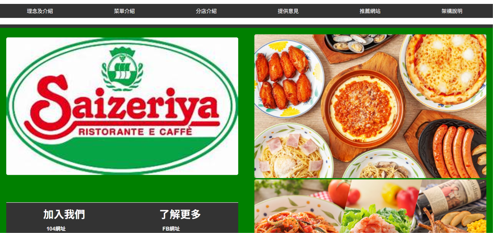
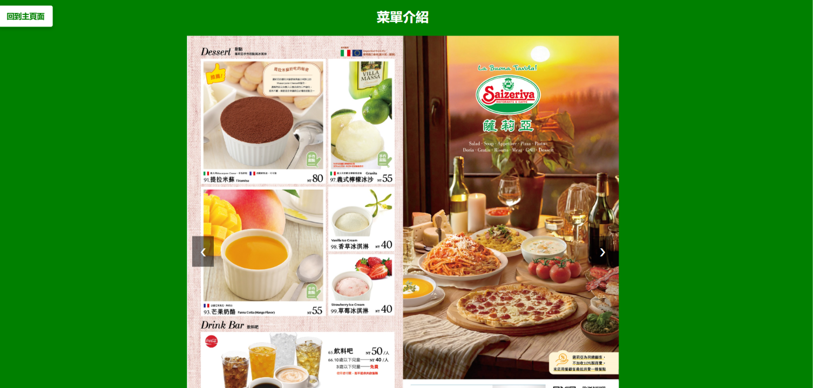
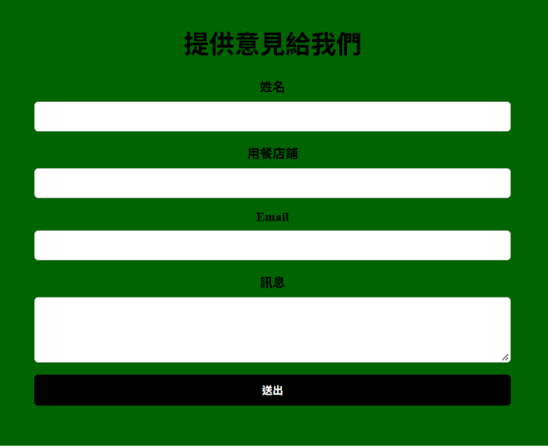
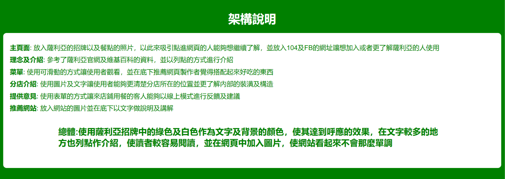

# 薩莉亞餐廳介紹網站 | Saizeriya Restaurant Website

## 專案簡介

本專案為大學 HTML 網頁設計課程的實作作品，以薩莉亞（Saizeriya）餐廳為主題，使用 HTML、CSS 及 JavaScript 製作多頁式介紹網站。

網站包含餐廳理念、菜單展示、分店資訊、意見回饋及推薦網站等頁面，並透過導覽列與圖片輪播功能，提升網站的操作便利性與互動性。

透過本次專案，學習網頁架構規劃、版面設計及基礎互動功能的實作。

## 使用技術

- **HTML**：建立網頁基本架構與內容
- **CSS**：設計網頁排版、配色及視覺樣式
- **JavaScript**：實作圖片輪播等互動功能

## 主要功能

1. **首頁導覽**：透過導覽列連結至各個功能頁面，並展示餐廳品牌與餐點圖片。
2. **餐廳介紹**：介紹薩莉亞的品牌理念與餐廳特色。
3. **菜單展示**：使用圖片輪播功能，讓使用者瀏覽不同的餐點資訊。
4. **分店介紹**：透過圖片與文字展示餐廳分店資訊。
5. **意見回饋**：設計包含姓名、用餐店鋪、Email 及意見內容的表單介面。
6. **推薦網站與架構說明**：介紹相關網站及本專案各頁面的設計理念。

## 專案畫面展示

### 1. 網站首頁

首頁以薩莉亞品牌的綠色為主要配色，搭配品牌 Logo、餐點圖片及上方導覽列，方便使用者瀏覽各個頁面。

### 2. 菜單介紹

透過圖片輪播功能展示餐廳菜單，使用者可點選左右箭頭切換圖片，瀏覽不同餐點。

### 3. 意見回饋表單

設計姓名、用餐店鋪、Email 及意見輸入欄位，讓使用者能夠填寫回饋與建議。

### 4. 網站架構說明

說明各頁面的功能與設計目的，以及網站整體的配色、版面配置與內容規劃。

## 專案特色

- 採用多頁式網站架構，整合不同類型的餐廳資訊。
- 使用導覽列連結各個頁面，方便使用者操作。
- 運用 CSS 設計網站版面與視覺風格。
- 結合 JavaScript 圖片輪播功能，增加網頁互動性。
- 透過 HTML 表單設計，練習使用者資料輸入介面。

## 學習收穫

透過本次專案，我學習到如何從網頁架構規劃開始，逐步完成頁面設計與功能實作，並了解 HTML、CSS 及 JavaScript 在網站開發中的應用。同時，也學習到如何整合不同頁面，讓網站具備完整的導覽架構與基本互動功能。

這次實作讓我對網站開發產生更濃厚的興趣，也為後續學習 ASP.NET Core MVC 及資料庫應用奠定基礎。

## 備註

本專案為大學課堂學習作品，主要展示前端網頁設計與基礎互動功能。意見回饋表單目前為前端介面展示，尚未串接後端資料庫。

